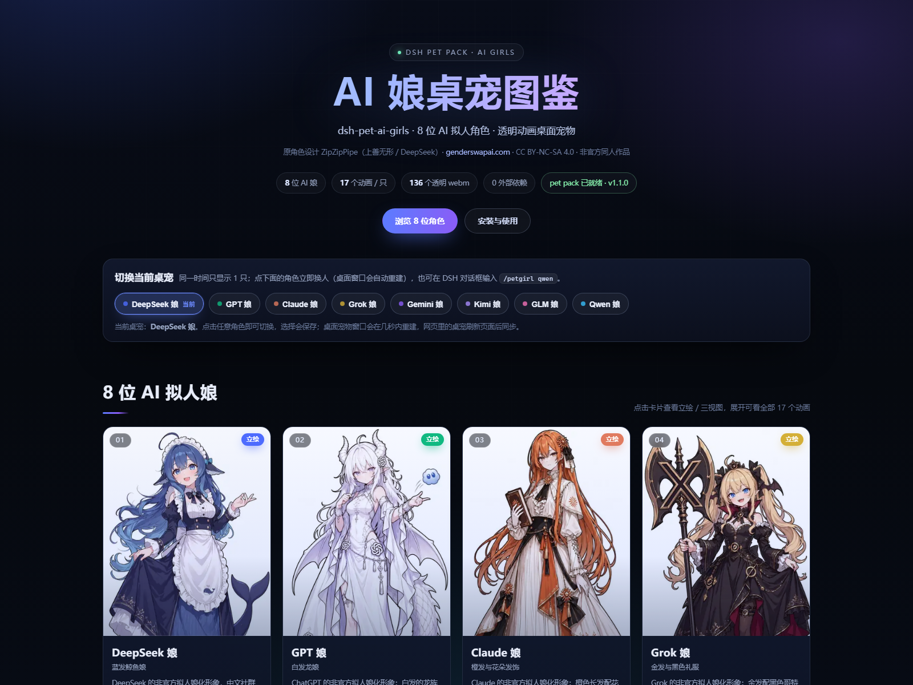
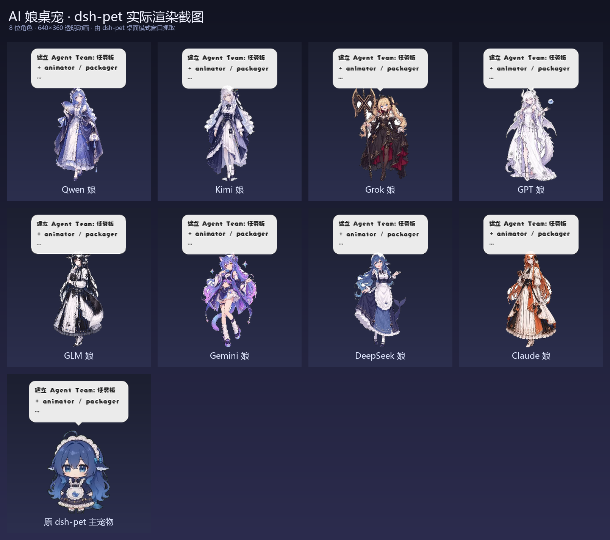
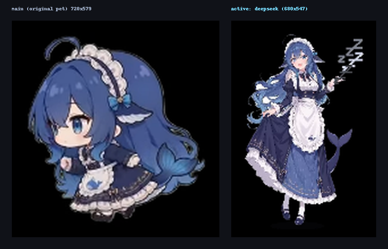
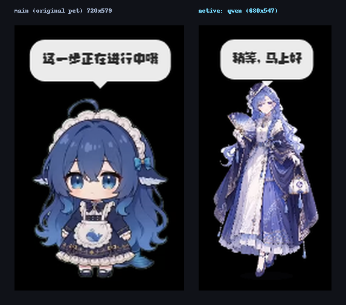

# AI 娘桌宠 · dsh-pet-ai-girls

把 [GenderSwapAI · AI 拟人角色图鉴](https://genderswapai.com/zh-TW/ai-gijinka) 里 8 位 AI 娘的立绘，做成了
**dsh-pet 透明动画桌面宠物**，并打包成一个可安装的 DSH 插件。

- 8 位角色：**DeepSeek 娘 / GPT 娘 / Claude 娘 / Grok 娘 / Gemini 娘 / Kimi 娘 / GLM 娘 / Qwen 娘**
- **同一时间只显示 1 只**（默认 DeepSeek 娘），可用 `/petgirl` 命令、图鉴页按钮或 API **自由切换**，选择会持久化
- 每位角色 **17 个透明动画**（待机 ×3、点击回应 ×3、拖拽、东张西望、碎碎念、工作状态 ×6、转圈、伸懒腰）
- 素材规格与 dsh-pet 原生素材一致：**640×360 / 24fps / VP9-alpha webm**，共 **136 个动画文件**
- 附带 **立绘 + 三视图图鉴页**（8 角色 × 立绘/三视图，灯箱浏览，纯本地资源）
- 插件会**自动把 pet pack 部署进 dsh-pet**：安装插件后每次启动自动同步素材，默认只显示 1 只，可随时切换

> 角色形象版权：原角色设计 **ZipZipPipe**（DeepSeek 娘原角色：上善无形），
> 来源 [genderswapai.com](https://genderswapai.com/zh-TW/ai-gijinka)，授权 [CC BY-NC-SA 4.0](https://creativecommons.org/licenses/by-nc-sa/4.0/deed.zh-hant)。
> 本项目为非官方同人二创，仅供个人欣赏与学习，请勿商用。详见 [NOTICE.md](NOTICE.md)。

> 仓库：<https://github.com/yqydy/dsh-pet-ai> · 代码 MIT · 角色素材 CC BY-NC-SA 4.0

---

## 预览

**图鉴页 + 顶部「切换当前桌宠」按钮组**（当前为 DeepSeek 娘）：



**8 位角色桌宠一览**（v1.0 全显示版，用于展示全部 8 个形象）：



**单宠显示 + 切换实测**：左=原 dsh-pet 主宠物，右=当前 AI 娘；下面是当前 DeepSeek 娘 与切换成 Qwen 娘后的真实桌面窗口抓图：





更多截图见 [`docs/screenshots/`](docs/screenshots/)；v1.1 复验报告见 [`docs/verify/REPORT-v1.1.md`](docs/verify/REPORT-v1.1.md)。

---

## 当前机器上的安装状态（Windows / DeepSeek Harness 桌面版）

| 项目 | 状态 |
| --- | --- |
| dsh-pet 用户数据里的 8 套 pet pack | ✅ 已部署到 `%USERPROFILE%\.dsh\dsh-pet\pet\`，**同一时间只显示 1 只**（默认 DeepSeek 娘） |
| 桌面模式宠物窗口 | ✅ 只剩 2 个窗口：原 dsh-pet 主宠物 + 当前 AI 娘（切换时会自动重建，见 `docs/screenshots/switcher-deepseek.png`） |
| 插件 `dsh-pet-ai-girls` v1.1.0 | ✅ 已装进 `%USERPROFILE%\.dsh\profiles\desktop\`（node_modules + package.json 依赖 + bundles + pnpm-lock），已热加载生效 |
| 切换能力 | ✅ `/petgirl` 命令 + 图鉴页「切换当前桌宠」按钮 + `/api/switch` API，选择持久化到 `pet/.dsh-pet-ai-girls-active.json` |
| 图鉴页 | `plugin/visual/index.html` 可直接双击打开；DSH 运行时可访问 `http://127.0.0.1:<DSH端口>/dsh-pet-ai-girls/` |

> 当前默认显示 **DeepSeek 娘**。在 DSH 对话框输入 `/petgirl` 查看当前与可选角色，`/petgirl qwen` 之类的命令即可换人；
> 或者打开图鉴页点顶部角色按钮。原 dsh-pet 主宠物（蓝毛小女仆）独立于本插件，可在 dsh-pet 设置页单独调整/隐藏。

---

## 怎么玩

- **切换当前桌宠（重点）**：在 DSH 对话框输入 `/petgirl`（留空=查看当前与全部可选），
  输入 `/petgirl qwen`（也接受 `Qwen 娘`、`girl-qwen`）即可换人；
  或打开图鉴页 `http://127.0.0.1:57076/dsh-pet-ai-girls/` 点顶部「切换当前桌宠」按钮组。
  切换后桌面宠物窗口几秒内自动重建，网页里的桌宠刷新页面后同步；选择会保存，下次启动仍是上次那只。
- **桌面上**：当前 AI 娘会出现在屏幕右下角，可以用鼠标**拖动 / 甩抛**，点一下有回应动画与爱心/星星；
  右键菜单可以点播动作、说话、回到初始位置、重载配置。
- **切换对话目标**：`/pet`（可输入 `girl-claude` 等 id 或「Claude 娘」），`/chat 你好` 与当前桌宠对话，
  `/chat` 留空让桌宠碎碎念一句。每个角色都有自己的性格人设。
- **工作状态联动**：Agent 思考 / 干活 / 完成 / 出错时，宠物会切换对应动画与气泡文案（每个角色文案不同）。
- **碎碎念开关**：为了不额外消耗 token，宠物默认 `whisperEnabled: false`；
  想听她时不时说一句，把当前 `girl-<id>-config.json` 里 `pets[0].whisperEnabled` 改成 `true`，刷新页面即可
  （碎碎念周期见 `eventsRefreshSec.whisper`，默认 1800 秒；用当前对话模型生成）。
- **大小 / 位置**：切换时插件会统一设为右下角 340×191 附近的同一个位置，方便原地换人；
  想自定义就改 `pet/girl-<id>-config.json` 里的 `size` 和 `position`（下次切换会被重新统一）。
- **隐藏当前 AI 娘**：把对应 config 的 `pets[0].display` 改成 `"none"` 并刷新；
  原 dsh-pet 主宠物可在 dsh-pet 设置页单独关闭。

---

## 8 位角色

| 角色 | id / 前缀 | 特征 | 登场动画 |
| --- | --- | --- | --- |
| DeepSeek 娘 | `girl-deepseek` | 蓝发鲸鱼娘、黑白女仆裙、爱吃白米饭 | 待机呼吸 / 原地漂浮 / 原地小憩 / 点击回应 ×3 / 拖拽 / 东张西望 / 碎碎念 / 工作状态 ×6 / 转圈展示 / 伸懒腰 |
| GPT 娘 | `girl-gpt` | 白发龙娘、龙角与翅膀、白色礼服、蓝色小团子 | 同上 17 个 |
| Claude 娘 | `girl-claude` | 橙发 + 花朵发饰、黑橙长裙、手不释卷 | 同上 |
| Grok 娘 | `girl-grok` | 金发黑礼服、黑色大十字戟、傲娇毒舌 | 同上 |
| Gemini 娘 | `girl-gemini` | 蓝紫渐变发、猫耳、异色瞳、星星装饰 | 同上 |
| Kimi 娘 | `girl-kimi` | 银紫长发、非对称女仆装、安静可靠 | 同上 |
| GLM 娘 | `girl-glm` | 黑发狐耳、黑白女仆裙、小恶魔毒舌 | 同上 |
| Qwen 娘 | `girl-qwen` | 蓝发圆发饰、团扇、蓝紫衣裙、温婉古风 | 同上 |

每位角色的人设（碎碎念/对话提示词）与工作状态文案见 `tools/spec.py` 和
`%USERPROFILE%\.dsh\dsh-pet\pet\girl-<id>-config.json` 的 `whisperPrompt` / `workStatusTexts`。

---

## 仓库结构

```text
dsh-pet-ai/
├─ plugin/                      ← 可安装的 DSH 插件 v1.1.0（host-only，随仓库提交）
│  ├─ package.json              name=dsh-pet-ai-girls，dsh.bundle.patch
│  ├─ cordis.patch.yml          insert id/name = dsh-pet-ai-girls
│  ├─ index.js                  宿主半侧：自动部署 pet pack + 单宠显示/切换 + 图鉴/切换 API
│  ├─ icon.png                  插件图标（8 头像拼贴，≤256KiB）
│  ├─ README.md                 插件自身说明
│  ├─ visual/                   图鉴页（立绘 / 三视图 / data.json / 切换按钮组）
│  └─ packs/                    8 个 girl-<id>-config.json + 8 个 girl-<id>-animation/（136 webm，77.6MB）
├─ reference/                  ← 原始素材：8 张立绘 webp + 8 张三视图 png（来自 genderswapai.com）
├─ tools/                      ← 可复现流水线
│  ├─ cutout.py                白底 → 透明抠图
│  ├─ animlib.py               640×360 纸片人动画引擎（17 个动作 + 粒子 + 阴影）
│  ├─ build_assets.py          全量渲染（8 worker，crf36，自检 + montage）
│  ├─ framecheck.mjs           Chrome/CDP alpha 边界检查（防裁切）
│  ├─ build_packs.py           生成 pet pack 配置 + 拷 webm，可 --deploy
│  ├─ switch_pet.py            单角色切换助手（/petgirl 的独立脚本版）
│  ├─ install_profile.py       安装插件到 DSH desktop profile（幂等，带备份）
│  ├─ gallery_build.py         生成图鉴图片/图标
│  ├─ test_host.mjs            宿主半侧冒烟测试（44 项）
│  ├─ verify_*.py / *.mjs      独立验证脚本（pack / live / plugin / switch / shots）
│  └─ spec.py                  8 角色人设、位置、17 动画元数据（单一事实源）
├─ docs/
│  ├─ screenshots/             ← 预览与验证截图（README 使用）
│  └─ verify/                  ← 独立验证报告（REPORT.md / REPORT-v1.1.md 等）
├─ README.md                   ← 本文件
├─ LICENSE                     ← 代码 MIT
└─ NOTICE.md                   ← 素材版权与致谢（CC BY-NC-SA 4.0）

# 以下为本地生成、已 gitignore（不随仓库提交，可由 tools/ 重新生成）：
#   build/   136 个动画母版、审核 montage、验证 JSON、截图原图
#   dist/    插件打包 zip（可用 plugin/ 目录重新打包）
```

---

## 安装（本机已装好；换机器/重装时）

前置：已安装 **dsh-pet v0.3.7+**（本插件依赖它渲染桌宠）。

1. 把 `plugin/` 整个目录复制到
   `%USERPROFILE%\.dsh\profiles\desktop\node_modules\dsh-pet-ai-girls\`。
2. 编辑 `%USERPROFILE%\.dsh\profiles\desktop\package.json`：
   - `dependencies` 加 `"dsh-pet-ai-girls": "file:node_modules/dsh-pet-ai-girls"`
   - `dsh.profile.bundles` 数组里在 `"dsh-pet"` 后面加 `"dsh-pet-ai-girls"`
3. 同步锁文件：`pnpm install --lockfile-only`（或忽略，插件装好后 DSH 首次启动会自行修复依赖）。
4. 重启 DSH。启动日志出现
   `[dsh-pet-ai-girls] v1.1.0 已部署 8 只 AI 娘桌宠 → ...\dsh-pet\pet（144 个文件） · 当前显示：DeepSeek 娘（/petgirl 切换） · 图鉴：http://127.0.0.1:<port>/dsh-pet-ai-girls/`
   即成功；刷新 DSH 页面后只会显示当前 1 只 AI 娘，用 `/petgirl qwen` 之类即可换人。

> 也可以不装插件、只做「素材包」：把 `plugin/packs/` 下的 8 个 `*-config.json` 和 8 个 `*-animation/`
> 目录直接复制到 `%USERPROFILE%\.dsh\dsh-pet\pet\`，刷新页面即可（本机当前就是这么做的 + 插件双保险）。

### 卸载

1. DSH 插件移除：删除 profile `node_modules\dsh-pet-ai-girls`，从 `package.json` 依赖与 bundles 里删掉对应项，重启 DSH。
2. 桌宠素材移除：删除 `%USERPROFILE%\.dsh\dsh-pet\pet\` 下 8 个 `girl-*-config.json` 与 `girl-*-animation\` 目录，刷新页面。
3. 本机安装时已自动备份：`package.json.bak-dshpetgirls-*`、`pnpm-lock.yaml.bak-dshpetgirls-*`，可直接还原。

---

## 技术实现（可复现）

1. **拉取素材**：从 genderswapai.com 下载 8 张立绘（webp，约 893×1600）与 8 张三视图 PNG（1536×1024）。
2. **抠图**：`tools/cutout.py` —— 从四边对近白像素做向量化 flood fill 得到背景连通域，
   生成 alpha 并 1px 内缩 + 0.9px 高斯柔化，去白边；白裙/白发角色同样干净。
3. **动画生成**：`tools/animlib.py` —— 以脚底为锚点做仿射变换的“纸片人”引擎，
   每帧在 640×360 画布上合成角色 + 地面阴影 + 粒子（爱心/星星/Zzz/汗滴/彩带/思考点），
   17 个动作的 pose 曲线全部程序化生成；一次性动画首尾回到中立姿态，循环动画首尾帧姿态完全一致。
4. **编码**：ffmpeg `libvpx-vp9`，`-pix_fmt yuva420p -auto-alt-ref 0 -metadata:s:v:0 alpha_mode=1`，
   640×360 / 24fps，crf 36，共 136 个 webm（77.6MB）。
5. **pet pack**：`tools/build_packs.py` 按 `tools/spec.py` 生成 8 份 dsh-pet 配置
   （人设、工作状态文案、动画池、权重、位置/大小），并把 webm 平铺进 `<prefix>-animation/`。
6. **插件**：`plugin/index.js` 在 DSH 启动时把 `packs/` 幂等部署进 dsh-pet 用户目录，
   并注册 `/dsh-pet-ai-girls/` 图鉴路由（防目录穿越、白名单 MIME、/health）。

---

## 验证与截图

- **单宠 + 切换证据**：[docs/screenshots/switcher-deepseek.png](docs/screenshots/switcher-deepseek.png)（main + 当前 DeepSeek 娘 两个窗口）、
  [docs/screenshots/switcher-qwen.png](docs/screenshots/switcher-qwen.png)（切换成 Qwen 娘后重建的窗口）、
  [docs/screenshots/gallery-switcher.png](docs/screenshots/gallery-switcher.png)（图鉴页顶部切换按钮组）
- 8 角色总览：[docs/screenshots/pets-wall-all8.png](docs/screenshots/pets-wall-all8.png)（v1.0.0 全显示版，保留作动画对照）
- 插件自测：`node tools/test_host.mjs` → **44 PASS / 0 FAIL / 0 SKIP**
- 切换自测：`python tools/switch_pet.py qwen` / `--status`，或 `GET /dsh-pet-ai-girls/api/current`
- 独立验证报告：[docs/verify/REPORT.md](docs/verify/REPORT.md) 与 v1.1 复验 [docs/verify/REPORT-v1.1.md](docs/verify/REPORT-v1.1.md)（PASS，P0=0 / P1=0）
- 切换端到端 JSON：[docs/verify/verify_switch.json](docs/verify/verify_switch.json)；自测输出：[docs/verify/test_host_output.txt](docs/verify/test_host_output.txt)
- 本地重建的附加证据（不随仓库提交）：`build/previews/<角色>-montage.png` 动画审核图、`build/verify/framecheck.json` alpha 边界检查

## 已知限制

- 同一时间只显示 **1 只** AI 娘（v1.1.0 起）；切换通过重写 pet pack 的 `display` + 调用 dsh-pet `POST /reload` 实现，
  桌面窗口立即重建，**网页里的桌宠需要刷新页面**才同步（dsh-pet 的网页 overlay 只在加载时读取配置）。
- 原 dsh-pet 主宠物（蓝毛小女仆）独立于本插件：它仍会显示，可在 dsh-pet 设置页调整大小/位置/隐藏，两者互不影响。
- 立绘是全身插画，程序化动画为“纸片人”级的呼吸/浮动/跳跃/粒子效果，
  与 dsh-pet 官方逐帧 AI 视频动画在动作丰富度上不同；素材与引擎一致保证 640×360 透明播放效果。
- 碎碎念/对话使用 DSH 当前对话模型，会产生 token 消耗；宠物默认关闭自动碎碎念。
- 角色形象版权归原作者（ZipZipPipe / 上善无形），CC BY-NC-SA 4.0，禁止商用。
- 脚底阴影在视频里贴到画布底边（比 dsh-pet 内置素材的 29px 底部留白略靠下），实机显示正常，属已知细节差异。
