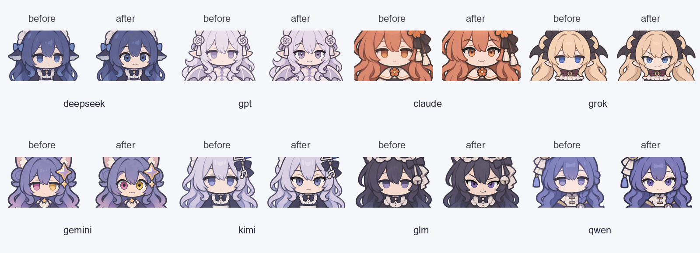
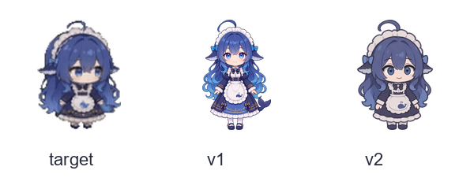
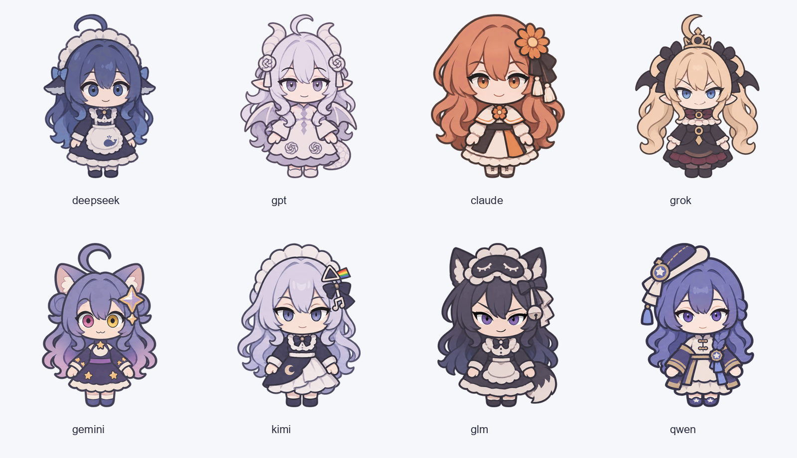
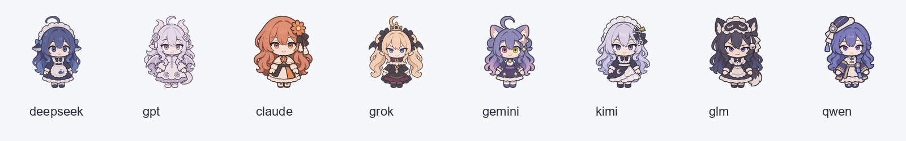

# 两头身重绘与动作修订（v2，2026-11-17）

## v2.1：眉眼与神态修订

用户反馈八个角色眼神过于相似、显得迷离。检查实际生成提示词，发现把参考图中的半眯眼也当作统一画风，多个角色被要求使用 sleepy/half-lidded eyes。这是本次修订的直接原因。

使用内置imagegen逐角色修改正面、侧面与悬空姿势的眼睛、瞳孔、眉毛和嘴型；保留两头身、服装、发型与配饰。眼神用上眼睑弧度、瞳孔焦点、少量高光、眉毛及嘴角配合表达，不靠所有角色一律瞪圆眼。

|角色|新的日常神态|
|---|---|
|DeepSeek|亲切好奇，蓝眼聚焦，眉毛柔和，浅笑|
|GPT|温柔可靠，淡紫杏眼舒展，安定浅笑|
|Claude|温暖聪慧，琥珀眼含笑，眉梢轻扬|
|Grok|自信俏皮，眼尾略扬，挑眉、嘴角轻翘|
|Gemini|活泼好奇，粉金异瞳睁圆，小猫般笑意|
|Kimi|清醒专注，眼形更利落，含蓄浅笑|
|GLM|机灵狡黠，紫色杏眼、挑眉与小坏笑|
|Qwen|温婉灵动，紫色杏眼柔和上扬、细眉浅笑|

全部立绘、三视图与绿/白首帧已重导出。136条视频提示词增加角色日常神态和逐动作表情变化，精简版仍不超过650字。外观锁定指脸型、发色、瞳色与服装，不要求眉眼和口型始终不动；小憩和发呆仅在各自中段允许困倦或短暂放空，结束要回到当前清醒首帧。

半眯眼旧源图与原始生成配方保留在[项目内归档](../reference/chibi-v2/archive/2026-11-17-half-lidded/README.md)。本次编辑的实际提示词、输入路径与输出SHA256记录于[image-generation.json](../reference/chibi-v2/image-generation.json)；文件入口保持兼容。

## 本次结果

8个角色已按用户上传的小桌宠参考重绘：大圆头、极短躯干和腿、紧凑发型裙摆、柔和暗轮廓、低饱和色块及少量明暗。保留各角色的配色和识别点，不再沿用v1偏修长、细节密集的插画比例。

这些是**已生成的参考图**。136条视频任务仍为 awaiting_video_generation；未使用视频模型生成新动作，也未替换当前插件中的旧程序动画。

## 上游核对范围

核对仓库 [PC2005-cloud/dsh-pet](https://github.com/PC2005-cloud/dsh-pet)，固定版本
[ef174bee](https://github.com/PC2005-cloud/dsh-pet/commit/ef174beecc79df76baf9ca06ed152237bbb96875)（2026-11-17查阅）。
读取完整动作配方、从零制作指南、抠像/归一化/编码脚本；实际抽查待机、挥手、点按、拖拽四段官方GIF的多时刻画面。

- [逐动作配方](https://github.com/PC2005-cloud/dsh-pet/blob/ef174beecc79df76baf9ca06ed152237bbb96875/prompts/桌面宠物%2010%20秒动作提示词.md)
- [制作指南](https://github.com/PC2005-cloud/dsh-pet/blob/ef174beecc79df76baf9ca06ed152237bbb96875/MAKE-YOUR-OWN-PET.md)
- [尺度归一化](https://github.com/PC2005-cloud/dsh-pet/blob/ef174beecc79df76baf9ca06ed152237bbb96875/scripts/normalize_step03.py)
- [播放编码](https://github.com/PC2005-cloud/dsh-pet/blob/ef174beecc79df76baf9ca06ed152237bbb96875/scripts/encode_thumbs.py)

上游的实际组合是：短小Q版人物 + 能读懂的表情与关节动作 + 克制的跟随运动 + 少量图形 + 干净透明边缘。其指南明确说明，发布成片全部采用PR手工抠像路线。自动抠像作为可复现兜底，不能据此承诺相同边缘效果。脚本注释里有旧的360×360表述，实际编码常量是640×360；本项目跟随实际代码。

## 上一版的问题与改动

| 项目 | v1问题 | v2处理 |
|---|---|---|
| 比例与细节 | 约2.5头身，裙身与腿偏长，金线花纹多 | 约2头身、短腿圆裙、简化色块，在128像素高度检查 |
| 首帧 | 站姿直接上移作为H，缺少悬空关节姿态 | 单独画第4个悬空姿势，手腕脚尖自然下垂 |
| 点按 | 额外生成面板、键盘、书笔，遮住身体 | 按上游用虚空交替点按，以手腕/手肘/视线表现忙碌 |
| 点击跳跃 | 跳跃和360度转圈捆在同一段 | 只做一次垂直小跳与落地缓冲 |
| 庆祝 | 转圈、武器、彩带等同时出现 | 小跳、轻踮脚拍掌、少量星星 |
| 提示词 | 外观与约束过长，主次动作和时间线有冲突 | 精简版≤650字、独立分镜版；二选一使用 |
| 角色专属道具 | 思考时变出书、折扇、陪伴生物 | 默认只保留清楚的思考姿态；复杂角色道具以后另做独立动作 |
| 版本混用 | 新任务仍可能指向v1图像 | 新任务全部引用reference/chibi-v2；新视频和输出另设v2目录 |

## 与上游17类动作逐项对应

保留当前插件的17个文件名和所有配置引用，动作内容按下表修订；不擅自把上游100余段全部塞进当前配置。

|当前文件名|上游对应标题|本次处理|
|---|---|---|
|待机呼吸|待机呼吸休闲|脚固定、轻呼吸与眨眼，减少张望以免抢掉待机|
|原地漂浮|原地漂浮踏步|内容改为原地交替踏步，保留旧文件名以兼容配置|
|原地小憩|原地小憩沉眠|短打盹后醒来；默认去掉Zzz，避免字符漂移|
|东张西望|东张西望|头与视线带动轻侧身，回正接下一段；特殊首尾差异见下|
|被鼠标拖拽悬空反馈|同名|使用真实H姿势的连续悬空循环，差异见下|
|点击回应-开心跃动|同名|单次垂直跳，不加旋转|
|点击回应-害羞惊讶|同名|贴脸颊、轻扭、偷看、恢复；不大幅侧转|
|点击回应-元气挥手|同名|一愣→双手招呼→歪头眨眼→回位|
|碎碎念-发呆碎碎念|同名|放空、小口型、回神挠头；无气泡无字|
|工作状态-思考冒泡|同名|托腮思考、点头；默认以圆点替代问号|
|工作状态-忙碌点按|同名|虚空交替点按，默认用一个齿轮代替四图标环绕|
|工作状态-清点归档|同名|查看两张纸、叠齐拍边；减少张数并省去卷纸变形|
|工作状态-原地踱步张望|同名|交握双手、换重心、左右轻望、小沙漏|
|工作状态-雀跃庆祝|同名|一次小跳，再轻踮脚拍掌；不用转圈|
|工作状态-垂头叹气冒汗|同名|垂肩、单滴汗、擦额、叹气、振作；省去额外红叉|
|转圈展示|小幅度原地360度旋转展示|独立承担完整转圈，不叠加跳跃；必须看三视图|
|伸懒腰|超大伸懒腰|伸展关节、哈欠、收势；不拉长身体或顶出画幅|

这里跟随上游的动作语义与制作约束，同时主动降低小物件的数量，提升图生视频可控性。需要更密的工具图标、问号或复杂特效时，先完成主体动作，再在后期按相同位置合成；不要在一次生成里叠加多组新对象。

### 两处必须公开说明的首尾适配

1. 上游“东张西望”还承担“偏左参考→镜像偏右参考”的资产制作功能，尾帧不回正。当前八角色配置会紧接普通动作，且Gemini异色瞳、Qwen编发与帽子、Kimi裙片不能镜像，因此本库采用S→S张望。没有照搬镜像终帧。
2. 上游拖拽源片是站立→悬空→落地。当前drag是重复播放的拖拽反馈；若每轮落地会反复站起，因此本库直接做H→H。需要严格复刻上游整段时，可以用S作首尾另生成起落源片，再抽取稳定悬空中段；不要把那段起落片直接当持续拖拽循环。

睡觉仍须按上游另做入睡S→P、睡眠P→P、醒来P→S，不能拿“原地小憩”充当睡眠循环。

## 使用顺序

1. 打开[角色索引](../prompts/chibi/README.md)，先选DeepSeek的待机、挥手、跳跃、点按、悬空五条。
2. 单人S或H是视频首帧；不要上传8人总览或四姿势图作首帧。转圈才额外附三视图，模型应将它当外观参考。
3. 默认复制“精简投喂版”，选10秒与16:9。视频平台支持首尾控制时，两端都用同一张S或H。精简版与详细版不要拼接。
4. 只有首帧控制的平台，不保证末帧准确回位。先挑合格候选，必要时补回位片段；不要用长交叉溶解盖住错位，否则会有重影。
5. 脸、肢体或配饰漂移时，先用“无叠加图形版”；它仅去掉额外图标，归档的两张纸仍保留。姿态变化过小，可以明确增加指定关节的幅度，不要放开镜头移动。
6. 每次只改一个问题：头身变化→加强首帧参考；手坏了→减点按次数；转身坏了→先做90°测试；图标乱了→后期补。平台参数名称各异，不虚构通用数值。
7. 原片保存在video/chibi-v2/<id>/<动作名>.mp4。依照[完整导入指南](MAKE-CHIBI-PET.md)完成抠像、定尺寸、检查、打包。

画风、镜头与动作配方已准备好，但尚无真实AI动作样片，不能承诺某个视频模型一次生成就达到上游成片效果。上游使用的豆包是来源说明，不代表所有版本与参数都能复现。

## 文件与复现

- [v2图像目录](../reference/chibi-v2/)：8张四姿势生成原图、8张三视图、8张单人立绘、32张独立姿势、32张绿/白首帧、风格参考、来源与校验。
- [图像生成提示词](../reference/chibi-v2/image-generation.json)：真实使用的内置imagegen配方；Gemini另记录去掉误加女仆发箍/围裙的定向修订。
- [任务清单](../prompts/chibi/jobs.json)：136个任务，含精简/详细/去图形三个版本、上游标题、S/H输入和配置字段。
- reference/chibi为v1历史图像，不移动不覆盖；旧提交0864d33可还原v1提示词。
- 上游临时GIF与抽查图在work/evidence/upstream，已忽略，不打入素材包。

~~~powershell
python tools/prepare_chibi_v2.py
python tools/build_video_prompts.py
python tools/video_pipeline.py plan
python -m unittest discover -s tests -v
~~~

署名和用途沿用[NOTICE.md](../NOTICE.md)，具体来源见[v2 sources.md](../reference/chibi-v2/sources.md)。
