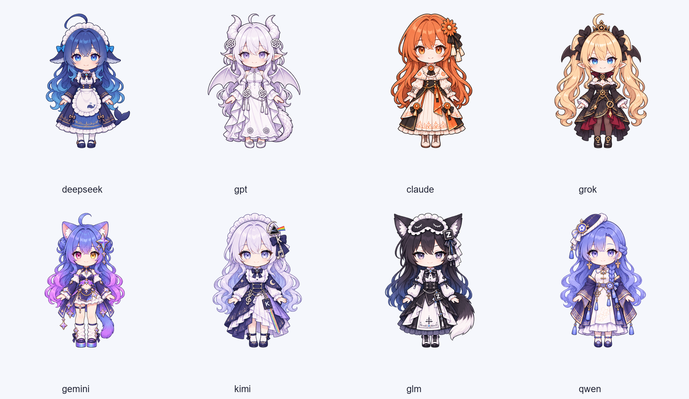

# 从零制作 Q 版桌宠：图片 → 视频 → 透明动画 → 角色包

## 本次仓库检查结论

原仓库的可复现路线是：白底立绘抠图 → 正侧背拆分 → Python 程序化姿态/粒子/转台 → 透明WebM → pet pack。
它能运行，但不等于上游的“AI绿幕视频逐动作生成”路线。旧代码还包含原作者电脑上的固定路径。
本次新增独立的AI视频路线，修复路径依赖及透明PNG处理，并保留原程序化路线供对照。

已完成：8张Q版透明三视图、8张单人透明立绘、24张归一化视角、8张站立首帧S、8张悬空首帧H、136条逐角色动作提示词。
尚待你用视频模型生成：136条Q版动作视频。
现有plugin/packs仍是原版程序化动画；本次没有把静态图冒充新动作视频，也没有修改你的本机DSH安装。

## 1. 使用已经制作好的Q版参考

- reference/chibi/turnarounds/<id>.png：每角色一张正面/侧面/背面原始生成图，带真实alpha。
- reference/chibi/portraits/<id>.png：单人透明定稿。
- reference/chibi/views/<id>-front.png、-side.png、-back.png：拆分、归一化后的视角。
- reference/chibi/firstframes/<id>.png：站立首帧S，1280×720纯绿幕。
- reference/chibi/firstframes/<id>-drag.png：悬空首帧H，与S使用相同缩放和水平锚点。
- reference/chibi/manifest.json：图像路径、源文件校验值、画布与足线参数。
- prompts/chibi/image-generation.json：8张三视图实际使用的内置imagegen提示词；原角色与风格参考一并保留。

这些图用于后续图生视频。不要再用旧版高挑立绘生成Q版视频，也不要把八人总览图当单人首帧。
每张AI三视图已检查正侧背、服装分区及耳角翼尾；它仍是二维参考，不代表存在可驱动的三维模型。

重新导出单人图与首帧：
~~~powershell
python tools/prepare_chibi.py
python tools/build_video_prompts.py
~~~

## 2. 安装制作依赖

在仓库根目录运行：
~~~powershell
python -m venv .venv
.\.venv\Scripts\Activate.ps1
python -m pip install -r tools/requirements.txt
~~~
Python 3.8+。FFmpeg依次使用显式 --ffmpeg 参数、PET_FFMPEG / FFMPEG_BIN、PATH、项目.tools路径、imageio-ffmpeg。
若显式配置的路径无效，会直接报错。新流水线工具、cutout入口和动画引擎使用项目相对路径，不依赖F盘旧目录。
原来的程序化动画引擎也改为通过同一FFmpeg查找逻辑工作。

## 3. 把提示词交给视频模型

打开[prompts/chibi](../prompts/chibi/README.md)，选择角色；每个角色文件都有17条完整提示词及首帧链接。
每条包含外观锁定、角色专属动作、0—10秒时间分段、负面词、源文件名、目标动画名及配置引用。

普通动作：上传对应S。支持首尾帧控制时，两端都使用同一张S。
拖拽：上传H，首尾维持悬空，不加落地过程。
转圈、侧身等动作：再附本角色Q版三视图，检查背面和配件连接。
建议先用DeepSeek的待机呼吸、元气挥手、拖拽、转圈展示验证模型效果，再生成全量。
模型不支持10秒时可按比例压缩分段。宿主不强制10秒，点击回应通常应剪成较短片段；不要机械地把10秒整段加速成1秒。

绿幕要求：16:9，背景#00FF00，无地面/阴影/绿光；原始视频可高分辨率，导入时统一1280×720与24fps。
所有身体部位、长发、翼尾、道具和特效保留安全空间。避免新增绿色光效。
Kimi彩虹发饰等原有绿色细节可能被颜色抠像误删；这类片段优先在剪辑软件用人工遮罩导出带alpha母版，再选择alpha导入路线。
角色固有的角耳翼尾与发饰全程保留；书、折扇、小面板等临时道具应在结束前消失。
视频平台提供干净源视频时直接使用，不需要照搬上游示例的固定水印遮罩。

## 4. 保存视频并查看进度

按原动作名保存，建议：
    video/chibi/deepseek/待机呼吸.mp4
    video/chibi/deepseek/被鼠标拖拽悬空反馈.mp4
    video/chibi/gpt/待机呼吸.mp4
MOV/WebM也支持。原片和中间产物已加入.gitignore，避免大视频误提交。
~~~powershell
python tools/video_pipeline.py plan
~~~
进度清单写到build/video/chibi/plan.json。jobs.json是厂商无关任务清单，不是某家平台的直接API格式。

## 5. 导入、抠像、统一锚点、编码

绿幕MP4：
~~~powershell
python tools/video_pipeline.py import --character deepseek --action "待机呼吸"
~~~
也可显式指定源路径：
~~~powershell
python tools/video_pipeline.py import --character deepseek --action "待机呼吸" --input "D:\my-videos\idle.mp4"
~~~
人工抠像后导出的透明MOV/VP9-alpha：
~~~powershell
python tools/video_pipeline.py import --character deepseek --action "待机呼吸" --input "D:\my-videos\idle.mov" --background alpha
~~~

工具按逻辑阶段依次执行：解码并统一源尺寸/帧率 → 软绿幕抠像或保留alpha → 固定尺度/水平锚点/足线 → VP9-alpha编码 → 解码验收。
为减少大中间文件，抠像、归一化和最终编码用管道串联；各阶段记录在report中，不必逐帧落盘。
输出build/video/chibi/step04/<id>/<原动画名>.webm及report、黑白背景首尾审核图。
处理不会自动安装或部署到DSH。

几何参数与上游归一化目标一致：2160×1215母版、站立身高900、脚底y=1115，最终640×360、24fps、无音轨。
源S的身高468、足线612；同一固定变换应用到所有帧。拖拽H的22px升高会保留，不能重新把悬空脚尖贴地。
不是按每一帧动态包围盒缩放，所以跳跃不会忽大忽小。超出最终画布会报错，不能用放大/裁切掩盖。

## 6. 验收

~~~powershell
python tools/video_pipeline.py verify --character deepseek --action "待机呼吸"
~~~
程序检查真实解码后的alpha、分辨率、帧率、无音轨、空帧、边缘裁切、首尾位置/尺寸与S/H足线及外观差异。
文件扩展名、alpha_mode标签或普通播放器的黑底截图都不能单独证明透明成功。
程序检查通过后仍要人工播放：看五官是否变形，耳角翼尾是否增减，非对称裙装和异色瞳是否镜像，转身是否合理，边缘是否有绿边，以及循环运动是否自然。
自动检查不等于语义与美术验收。

## 7. 136条齐全后再更新动画包

~~~powershell
python tools/video_pipeline.py pack
~~~
必须8×17条全部存在且重新验收通过，才会写入build/video/chibi/plugin/packs。
保持原文件名和配置，因此切换、工作状态和动作池可继续沿用。缺少视频时直接退出，不生成残缺包。
确认暂存包后更新仓库内的plugin/packs：
~~~powershell
python tools/video_pipeline.py pack --write-plugin
~~~
该命令先备份现有packs与package.json到build/video/chibi/backups，再替换对应136条视频，并递增插件补丁版本，以触发部署版本标记更新。
它不直接改用户的.dsh目录。然后按现有插件安装方法安装新plugin、重启DSH，检查真实桌面效果。

不要把新视频放进build/webm后又运行旧build_assets.py，它会重新生成旧程序化动画。两条路线使用不同目录。
旧build_packs.py仍供原路线使用；新路线用video_pipeline.py pack，避免来源混淆。

## 8. 睡觉与小憩

当前17条中的原地小憩是短打盹，结尾应清醒回S。配置没有真正的睡觉套。
将来增加右键睡觉时，另做入睡S→P、睡眠循环P→P、醒来P→S，并写入animations.sleep。
三段沿用同一地面基线、大小和镜头，不能在每个循环末尾站起来。

## 9. 本地验证

~~~powershell
python -m unittest discover -s tests -v
~~~
测试覆盖Q版素材与136条映射完整性、透明白色细节、固定尺度、真实FFmpeg绿幕与alpha导入、失败输入拦截以及不完整素材包阻止发布。
测试使用短的合成样片，不宣称已经验证尚未生成的136条AI视频或真实DSH安装。

## 上游依据

- [完整从零流程](https://github.com/PC2005-cloud/dsh-pet/blob/main/MAKE-YOUR-OWN-PET.md)
- [角色包配置](https://github.com/PC2005-cloud/dsh-pet/blob/main/CONFIG.md)
- [尺度归一化实现](https://github.com/PC2005-cloud/dsh-pet/blob/main/scripts/normalize_step03.py)
- [实际640×360编码实现](https://github.com/PC2005-cloud/dsh-pet/blob/main/scripts/encode_thumbs.py)

原角色与素材署名继续见[NOTICE.md](../NOTICE.md)。Q版为依据原角色的AI辅助二创，保留原有素材授权说明。
